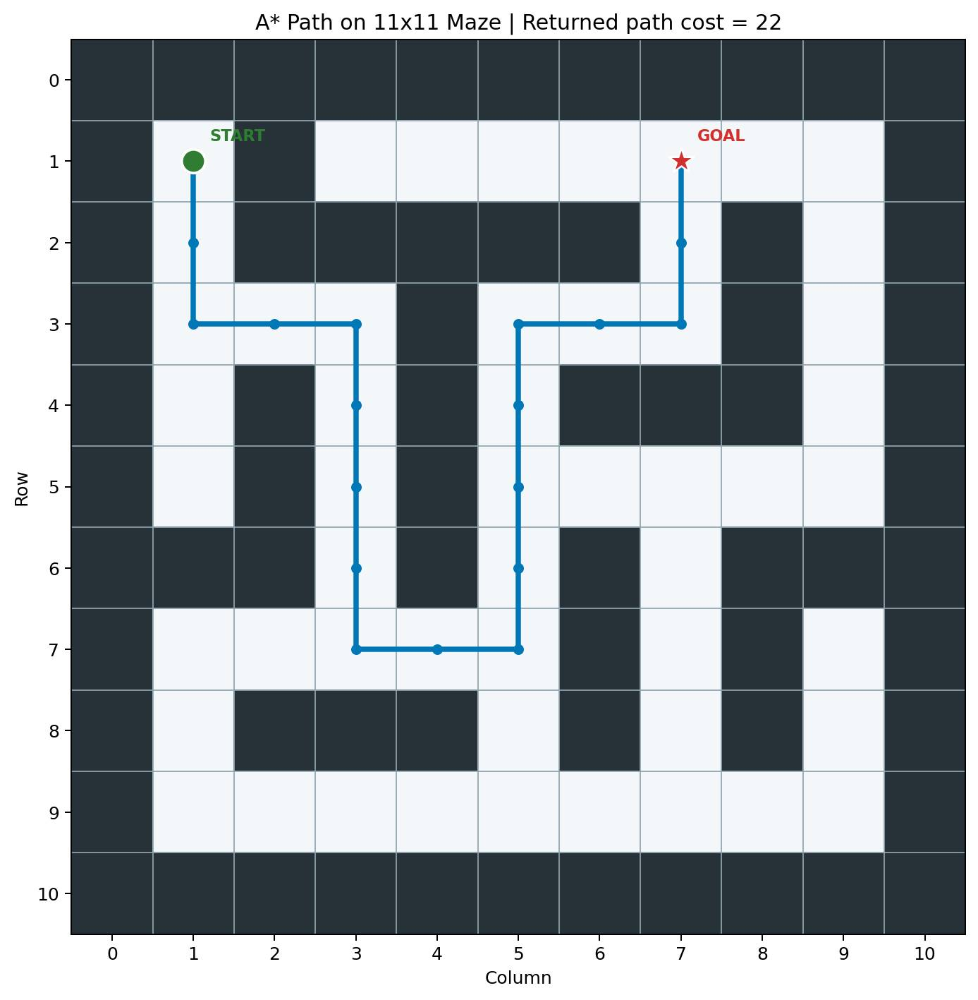

# A* Maze Pathfinding

A Python implementation of the A* search algorithm that finds the cheapest path through a 5×5 maze with a bridge and a river. Developed as an AI course assignment.

## Problem

A chick wants to reach its mother (the hen) in a 5×5 maze (see [`problem.jpg`](problem.jpg)).

- Moves: left, down, right, up. When several moves are equally good, they are preferred in this order.
- Every move costs 1, except:
  - crossing the **bridge** costs `x`
  - crossing the **river** costs `y`
- `x` and `y` are derived from the student numbers, as defined in the assignment.

The task: find the path the chick takes, the cells that are explored, and the total cost.

## Approach

### Maze representation

The maze is stored in `a_star_maze.py` as an 11×11 grid: the 5×5 cells sit at odd coordinates, and the entries between them are walls (`0`) or openings (`1`). The code converts this grid into a graph of 5×5 cells, so every move goes from one cell to a neighboring cell.

### Cost function

- A normal move costs `STEP_COST = 1`.
- The two special connections (bridge and river) are defined once in `SPECIAL_MOVES` and have their own cost, `BRIDGE_COST` and `RIVER_COST`. They replace the normal cost for that move.
- All constants are at the top of the file, so you can change `x` and `y` and run again.

### Heuristic

Manhattan distance to the goal, scaled by the cheapest possible move cost:

```
h(a, b) = cheapest_move_cost * (|a.row - b.row| + |a.col - b.col|)
```

It never overestimates the real remaining cost and is consistent, so A* returns an optimal path and each cell needs to be expanded only once.

### Algorithm

A* keeps an open list ordered by `f(n) = g(n) + h(n)`, where `g(n)` is the cost from the start and `h(n)` is the heuristic. Equal `f` values are resolved by insertion order, which follows the move priority (left, down, right, up).

## How to Run

Python 3 is required. No third-party packages are needed.

```bash
python a_star_maze.py
```

## Example Output

With `BRIDGE_COST = 4` and `RIVER_COST = 2`:

```
Path: [(0, 0), (1, 0), (1, 1), (2, 1), (3, 1), (3, 2), (2, 2), (1, 2), (1, 3), (0, 3)]
Expanded cells (in order): [(0, 0), (1, 0), (1, 1), (2, 0), (2, 1), (3, 1), (3, 2), (2, 2), (2, 3), (1, 2), (3, 0), (4, 2), (3, 3), (2, 4), (4, 3), (1, 3), (1, 4), (0, 3)]
Total cost: 12
```

Coordinates are `(row, column)` in the 5×5 maze, starting at `(0, 0)`. The path crosses the bridge between `(1, 2)` and `(1, 3)`: 8 normal moves (cost 1 each) plus the bridge (cost 4) give a total of 12.



## Why A*?

- **Uses the costs.** Unlike BFS, A* handles moves with different costs, such as the bridge and the river.
- **Guided search.** Unlike Dijkstra's algorithm, which expands cells in every direction, A* uses the heuristic to prefer cells that are closer to the goal, so it usually expands fewer cells.
- **Optimal.** With an admissible and consistent heuristic, the returned path has the lowest possible cost.

## Files

- `a_star_maze.py`: A* implementation and the maze
- `problem.jpg`: the original problem illustration
- `astar-maze-output.png`: visualization of the resulting path

## Authors

Mobina Zangooie and Fateme Gheidy
